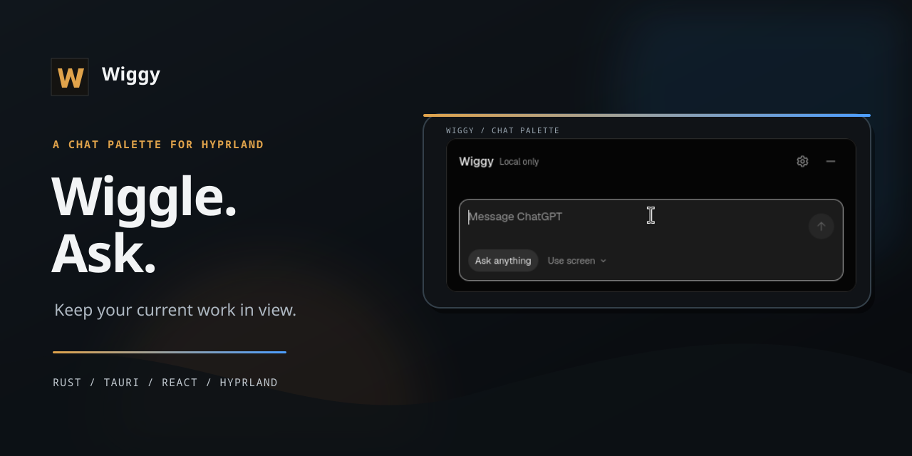
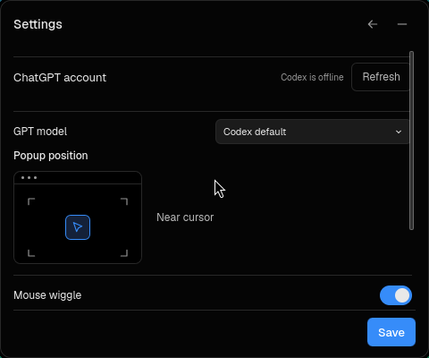

# Wiggy

**A small chat palette for Hyprland. Wiggle the mouse to bring it into view.**

Ask a question without leaving your current workspace. Attach a screen capture
only when you choose, then send it with your message. Wiggy reuses the ChatGPT
login provided by Codex, so there is no API key or second sign-in.

<p align="center">
  
</p>

<p align="center">
  <a href="https://github.com/radiationnss/wiggy/actions/workflows/verify.yml"></a>
  <a href="https://github.com/radiationnss/wiggy/actions/workflows/package-arch.yml"></a>
  
  
</p>

## What it does

- Summons a compact floating chat palette with a deliberate mouse wiggle.
- Uses the existing local Codex app-server and ChatGPT login.
- Lets you capture a region, display, or visible window and attach it yourself.
- Keeps the message and screenshot as a draft until you press **Send**.
- Provides a GPT model picker and controls for popup placement and wiggle sensitivity.

The terminal and arbitrary shell execution are not part of the app.

## Built with

Rust and Tauri handle the desktop window, Hyprland integration, and local
app-server connection. React and TypeScript render the palette and settings.
The project includes an Arch package recipe and CI that builds and install-tests
the package.

## Screenshots

<p align="center">
  
</p>

The settings capture shows the offline state. Start Codex on the same computer,
then choose **Refresh** in Wiggy Settings to connect the existing account.

## Install on Arch Linux

Wiggy currently targets **Arch Linux x86_64** with **Hyprland 0.55 or 0.56**.
Other Linux distributions and compositor versions are not verified.

1. Open the [Arch package workflow](https://github.com/radiationnss/wiggy/actions/workflows/package-arch.yml), choose the latest successful run, then download the `wiggy-arch-x86_64` artifact.
2. Extract the downloaded archive and verify it:

   ```sh
   sha256sum -c SHA256SUMS
   ```

3. Install the package. Pacman will resolve the declared runtime dependencies:

   ```sh
   sudo pacman -U ./wiggy-*-x86_64.pkg.tar.zst
   ```

The CI artifact is temporary. A version tag will build and attach the package
to a **draft GitHub Release** for review before it is published. There is no
published release yet.

If pacman reports mirror `404` errors while downloading dependencies, refresh
the package databases and complete a full system upgrade before retrying:

```sh
sudo pacman -Syu
```

Arch does not support partial upgrades. If `404` errors remain after a full
upgrade, refresh the mirror list and try again. See the
[ArchWiki pacman troubleshooting guide](https://wiki.archlinux.org/title/Pacman#Packages_cannot_be_retrieved_on_installation).

## First launch

1. Open **Wiggy** from the application menu. It stays available in the tray
   after you hide the palette. Keep Wiggy running for mouse summon to work.
2. Open **Codex** and sign in with ChatGPT if needed. In Wiggy, open Settings
   and choose **Refresh**. No second Wiggy sign-in is required.
3. Leave **Mouse wiggle** enabled in Settings and move the pointer in a quick
   back-and-forth gesture.

Hyprland 0.55/0.56 uses a Lua config. To start Wiggy at login, following
[Hyprland's autostart guide](https://wiki.hypr.land/Configuring/Basics/Autostart/), add this to
`~/.config/hypr/hyprland.lua`:

```lua
hl.on("hyprland.start", function()
  hl.exec_cmd("wiggy")
end)
```

For local diagnostics, run `wiggy --diagnose`. Mouse summon is supported only
on the Hyprland versions listed above. The tray menu can open the palette or
Settings if summon is unavailable.

## Screenshots and chat data

Wiggy captures a screen only after you choose **Use screen**. Capturing or
previewing does not send it. When you press **Send**, the image is passed to
Codex through a private temporary file that Wiggy removes when the turn ends.
This describes local file cleanup only; retention by Codex or the model service
depends on those services.

## Build from source

Source builds need Node.js/npm, Rust, and the Tauri Linux development libraries.
On Arch, the main build packages are `nodejs`, `npm`, `rust`, `webkit2gtk-4.1`,
`gtk3`, `libappindicator`, `librsvg`, and `pkgconf`.

```sh
git clone https://github.com/radiationnss/wiggy.git
cd wiggy
makepkg -si
```

The source build uses the same Arch package recipe as CI. See
[the architecture notes](docs/architecture.md) and
[the production roadmap](docs/roadmap.md) for current constraints and remaining
work.
